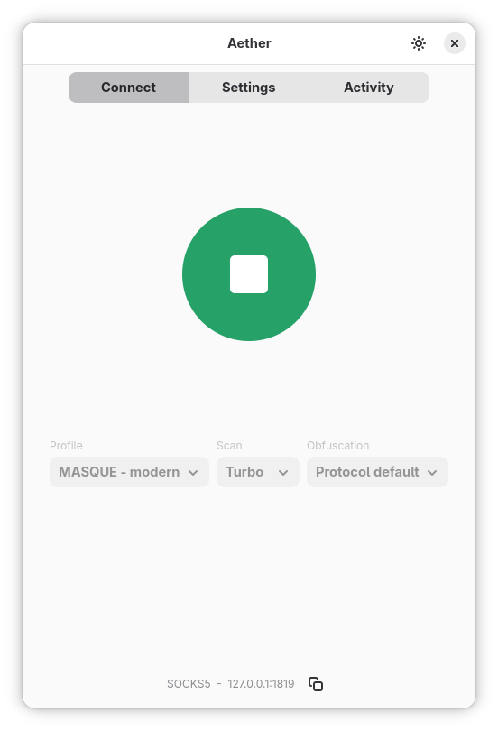
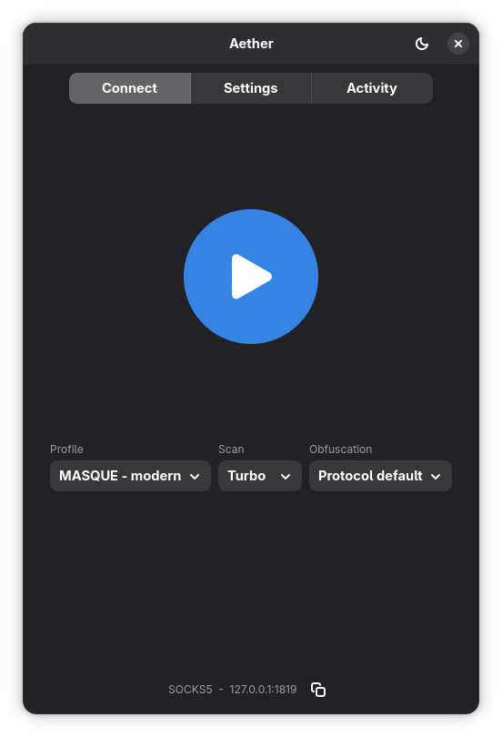

<p align="center">
  
</p>

<p align="center">
  A desktop app for <a href="https://github.com/CluvexStudio/Aether">Aether</a>. Choose a connection profile, manage your connection, and check activity from one window.
</p>

<p align="center">
  
  
</p>

## Install

```sh
curl -fsSL https://raw.githubusercontent.com/evokelektrique/AetherGTK/main/install.sh | bash
```

The installer sets up Aether for your user. No `sudo` needed.

<details>
<summary>Install a specific release</summary>

```sh
curl -fsSL https://raw.githubusercontent.com/evokelektrique/AetherGTK/main/install.sh | bash -s -- v0.1.1
```

</details>

<details>
<summary>Uninstall</summary>

```sh
curl -fsSL https://raw.githubusercontent.com/evokelektrique/AetherGTK/main/install.sh | bash -s -- uninstall
```

This removes Aether GTK, its Psiphon helper, and saved app settings.

</details>

GTK 4 and libadwaita are required. The GNOME Quick Settings extension supports GNOME Shell 45 through 51. Other desktops can launch Aether from the app menu.

## Build from source

Install Rust 1.98 or newer, GTK 4 and libadwaita development packages, CMake, Clang, and pkg-config. Then clone the project with its Aether submodule:

```sh
git clone --recurse-submodules https://github.com/evokelektrique/AetherGTK.git
cd AetherGTK
cargo run
```

On Fedora, install the build dependencies with:

```sh
sudo dnf install rust cargo gtk4-devel libadwaita-devel cmake clang clang-devel openssl-devel pkgconf-pkg-config
```

On GNOME, install Quick Settings from a source checkout with `bash scripts/gnome-integration.sh install`. Release downloads include Psiphon support; source builds can install it from Settings and need Go, Git, Bash, and network access.

## Changelog

See [CHANGELOG.md](CHANGELOG.md).

## License

This project and the Aether core are licensed under AGPL-3.0-only. Psiphon Tunnel Core is distributed under GPL-3.0; its source and license are included with each release. See [LICENSE](LICENSE) and the Aether license in `vendor/Aether/LICENSE`.
